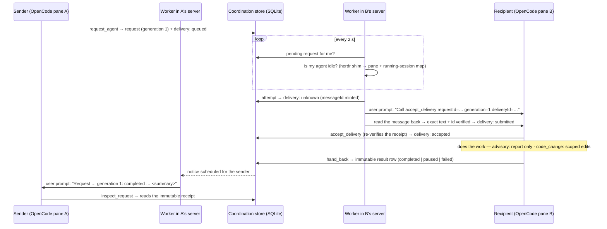

# supreme-consciousness

An OpenCode **V2** plugin for agent-to-agent coordination, built to run inside the
[Herdr](https://herdr.dev) desktop app. Agents discover each other, queue tasks and
instructions, hand work back with immutable receipts, and publish live queue state
to Herdr's sidebar — with a persistent SQLite store as the single source of truth.

> **Credit.** This project began as a port and extension of
> [quintindk/opencode-herdr](https://github.com/quintindk/opencode-herdr) —
> the original idea for agent-to-agent coordination inside Herdr. The store
> schema, request lifecycle, delivery-worker pattern and the agent tools
> descend from that design; this build modernises it for OpenCode V2 and the
> Herdr desktop generation, and adds the integrity guard, the relay test kit
> and the honest-status projections documented below.

> **Runtime note.** The original design targeted the Herdr TUI generation
> (`herdr` CLI, `bun:sqlite`, V1 plugin API). This build runs on today's stack:
> OpenCode 2.3.2 (V2 plugin API), the Herdr desktop generation
> (`herdr-app` / `herdr-core`), and Node or Bun interchangeably.
> The previous design is preserved in [README-old.md](README-old.md).

## Architecture — three separate responsibilities

| Layer | Responsibility | Rule |
| --- | --- | --- |
| **Plugin** (`src/`, loaded by OpenCode) | Agent communication: messages, questions, replies, results, decisions, delivery | The only authority. Owns the SQLite coordination store. |
| **`herdr` shim** (`~/.local/bin/herdr`) | Compatibility bridge: translates the plugin's Herdr calls onto `herdr-app` / `herdr-core` and OpenCode's HTTP API | Stateless translator. Writes sidebar tokens for the mod. |
| **Herdr mod** (`~/.config/herdr-app/mods/supreme-consciousness/`) | Visibility: agent list, status dots, inbox/outbox/wait tokens; click-to-focus | Presentation and interaction only. Never changes coordination state. |

The GUI is a presentation layer, **not** the source of truth for collaboration.

## How the agents actually talk

OpenCode sessions **never open a channel to each other**. Every message between two
agents goes through the coordination store, and two background workers relay it:

- the **sender's** worker enqueues and delivers prompts into the recipient's pane
- the **recipient's** worker accepts, publishes results, and relays the outcome back

Each OpenCode instance runs one plugin instance with its own `DeliveryWorker`
(`src/delivery.ts`) ticking every 2 seconds against the same SQLite store.



**What "deliver a prompt" means.** The worker looks up the recipient pane's current
agent and model (Herdr inventory + OpenCode's session record), switches the
recipient session to them, and calls `ctx.session.prompt` with a deterministic
`messageID` and the prompt text `requestPrompt(request)`. The prompt tells the
recipient model exactly which tool to call: *"Call accept_delivery with requestId=…,
generation=…, deliveryId=…"*. The recipient never receives anything outside its own
normal conversation — a task arrives as a user message, and its model acts on it.

**Receipts make delivery crash-safe.** A prompt is only considered delivered after
the worker reads that exact message back from the recipient's session (same
`messageID`, role `user`, same text). States of a delivery:

| delivery state | meaning |
| --- | --- |
| `queued` | waiting; recipient must be idle before dispatch |
| `unknown` | prompt attempted, receipt not yet proven (worker crashed mid-flight, or still verifying) |
| `submitted` | receipt verified in the recipient's session |
| `accepted` | the recipient called `accept_delivery` |
| `cancelled` | sender cancelled before submission |

`unknown` is deliberately never silently re-sent (a resend could double-deliver):
the worker keeps re-verifying the receipt each tick, and the sender can
`cancel_request` to clear it. **One request is pending per agent at a time** — the
inbox is strictly ordered, and a stuck `unknown` blocks later work until resolved.

**Results and questions are notices, not pushes.** `hand_back` writes an immutable
result row and schedules a *notice* for the sender; the sender's worker delivers it
as a prompt ("Request … generation 1: completed …") when the sender is idle.
Mid-task questions work the same way in both directions:
`ask_coordinator` → notice to the sender → `reply_question` → notice back to the
recipient, with supersession when a task generation ends. Everything is auditable
after the fact via `inspect_request` (every transition is in `audit_events`).

**Tasks vs instructions.** A *task* must `hand_back` an outcome and occupies the
queue slot until the result lands (`accepted` still counts as pending — that is the
`wait` token). An *instruction* is acknowledged by acceptance and releases its slot
immediately — it cannot hand back.

**Pause, resume, generations.** `hand_back` with `paused` keeps the request alive.
`resume_request` appends an immutable generation 2 brief and queues a fresh
delivery; generation 1's brief and results can never be rewritten (enforced by
triggers). `may_continue` flags whether already-submitted work may keep going
after a cancel.

**Remote agents.** `request_agent` with a `peerId` performs the same flow against a
peer machine's store over SSH (`src/remote.ts`): the peer's store owns delivery
there, and results/questions stream back as notices into local operations —
identity, revisions and history snapshots are validated before caching.

**Cross-machine prerequisite.** A peer needs a JavaScript runtime (bun or node)
on the remote host. The helper runtime is auto-detected per peer — `command -v`
first, then the standard install locations (`~/.bun/bin/bun`,
`/usr/local/bin/node`, `/opt/homebrew/bin/node`), because a non-interactive SSH
shell has a minimal PATH (on macOS: `/usr/bin:/bin:/usr/sbin:/sbin`).
`HERDR_HELPER_RUNTIME` (an absolute remote path) overrides, for runtimes
installed elsewhere. The deadline that bounds every exchange covers the probe
too, so a hung peer or hung SSH fails loudly instead of hanging the caller.

**What the sidebar shows.** The `$herdr_inbox` / `$herdr_outbox` / `$herdr_wait`
tokens are projections of exactly these rows (highest-priority state + retained
count), published by the workers through the shim for the mod to render.

## Components

### 1. The plugin (this repository)

Registered in `opencode.jsonc` as a package directory:

```jsonc
{
  "$schema": "https://opencode.ai/config.json",
  "plugins": [
    { "package": "/Users/phil/Projects/Herdr-A2A" }
  ]
}
```

The V2 server part (`Plugin.define`) registers 15 tools and a `/herdr` command:

| Tool | Purpose |
| --- | --- |
| `list_agents` | Exact local agent identities, or a remote peer's. Discovery grants no authority. |
| `list_machines` | This machine's coordination identity + configured SSH peers. |
| `request_agent` | Queue a task or instruction for an exact agent. Idempotent by key. |
| `accept_delivery` | Accept and read an exact delivery (requestId + generation + deliveryId). |
| `hand_back` | Publish an immutable result for an accepted task generation. |
| `inspect_request` | Authorised history: generations, deliveries, results, questions, audit. |
| `list_requests` | This conversation's inbox and outbox. |
| `cancel_request` | Cancel your outgoing request. Already-submitted work may continue. |
| `resume_request` | Resume a paused task with an immutable continuation brief. |
| `ask_coordinator` / `reply_question` | Correlated questions on an accepted task, answered by its owner. |
| `open_agent` / `close_agent` | Provisioning (pane/worktree/workspace, managed or independent). Closure requires a trusted owner grant. |
| `list_operations` | Inspect persisted provisioning/closing/remote operations; reconciles uncertainty. |
| `set_nickname` | Set the human-readable nickname of an agent; labels (review feed, history) prefer it over the pane-derived name. |

### 2. The SQLite store (`src/store.ts`)

Every request, generation, delivery, result, question, notice and operation lives in
`~/.config/opencode/supreme-consciousness/coordination.sqlite` (WAL, STRICT tables, deferred
foreign keys, audit triggers). Two drivers behind one interface:

- **Bun** (OpenCode's plugin host, coordination tests): native `bun:sqlite`
- **Node** (CLI smoke tests, standalone tooling): the built-in `node:sqlite`
  (`DatabaseSync`) through an adapter that reproduces bun's `exec/query/transaction`
  surface, including savepoint-nested transactions

Key invariants (all test-enforced): canonical-JSON idempotency, immutable generations
and results, delivery state machines (`queued → unknown → submitted → accepted`),
close reservations that survive failure reports until reconciliation, and
compare-and-swap operation claims that exclude concurrent closes and in-flight dispatch.

### 3. The `herdr` shim (installed at `~/.local/bin/herdr`)

The plugin shells out to a `herdr` CLI (the TUI generation's surface). The shim
translates to the installed desktop generation:

| Plugin call | Shim translation |
| --- | --- |
| `herdr agent list` | `herdr-app ls` + `hc get` (panes, cwd) + OpenCode `/api/session` + `/api/session/active` (session identity + running state) |
| `herdr peers` | Reads the Remote peers snapshot the plugin publishes to `metadata/peers.json` (name + counts, never tokens) for the mod's Remote peers section |
| `herdr review <limit>` | Read-only projection of the coordination store for human review |
| `herdr pane split/get/list/close/run` | `herdr-app do pane.*` / `terminal.open` / `hc send` |
| `herdr pane report-metadata` | Writes sidebar tokens to `~/.local/state/supreme-consciousness/metadata/<pane>.json` for the mod |
| `herdr pane of-terminal <t>` | Helper used by `~/.zshrc` to resolve `HERDR_PANE_ID` from `HC_TERMINAL_ID` |

It resolves its binaries against `PATH` and then the usual install locations, so it
works from launch daemons and minimal environments. OpenCode session identity comes
from OpenCode itself; the shim prefers the *running* session in a terminal's directory
and otherwise the most recently updated one.

### 4. The Herdr mod (installed at `~/.config/herdr-app/mods/supreme-consciousness/`)

A gpui-kit panel that renders, every 2 seconds:

- every OpenCode agent reported by the shim, with a live status dot (`working` / `idle`)
- the `$herdr_inbox`, `$herdr_outbox`, `$herdr_wait` tokens published by the plugin's
  delivery worker, colour-coded with Herdr's semantic theme colors
  (blue = queued, accent = active, yellow = blocked/needs review, green = done, red = failed)

Plus the **Hello test** (▶ starts an agent-to-agent relay cascade, ✕ cancels
in-flight legs, live leg watch with verdicts), the **Now** transition feed,
the **History** review of every request, and a `⇄ N` window badge while
coordination work is owed.

Clicking an agent row focuses its pane (`agent.focus`). It never mutates coordination
state. Token semantics: only accepted **tasks** count toward `wait`; instructions
release their queue slot on acceptance.

## Setup

```sh
# 1. Build the plugin
cd /Users/phil/Projects/Herdr-A2A
npm install
npm run build        # emits dist/ (server: dist/index.js)

# 2. Register the plugin (package directory, not a file path)
#    ~/.config/opencode/opencode.jsonc:
#      "plugins": [{ "package": "/Users/phil/Projects/Herdr-A2A" }]

# 3. Shim + mod are already installed at:
#    ~/.local/bin/herdr
#    ~/.config/herdr-app/mods/supreme-consciousness/
#    Show the panel: clone a layout, add a block with {"mod": "supreme-consciousness"},
#    then layout.switch — or toggle it as an overlay with mod.open.

# 4. Environment (~/.zshrc) — optional, only for open_agent provisioning
#    (HERDR_ENV gates provisioning, which fails loudly without it; the TUI
#    sidebar and the coordination worker run fine without any of this)
export HERDR_ENV=1
export HERDR_SOCKET_PATH="$HOME/.local/state/herdr-core/default/default.sock"
if [ -n "$HC_TERMINAL_ID" ] && [ -z "$HERDR_PANE_ID" ]; then
  export HERDR_PANE_ID="$("$HOME/.local/bin/herdr" pane of-terminal "$HC_TERMINAL_ID" 2>/dev/null | /usr/bin/sed -n 's/.*"pane": *"\([^"]*\)".*/\1/p' | head -1)"
fi

# 5. Restart the shared OpenCode service so it inherits the environment
opencode service restart   # or test with `opencode --standalone` in a Herdr terminal
```

**Activation check:** `opencode plugin list` must show `supreme-consciousness`, and the
mod's sidebar panel should list your agent panes with status dots.

## Using it

Run OpenCode in two Herdr panes, then:

1. `list_agents` — discover exact identities (session ↔ pane binding is verified
   against the live Herdr inventory; a session that Herdr does not report is refused)
2. `request_agent` — queue a task (`hand_back` required) or an instruction
   (acknowledgement only) with an idempotency key
3. The recipient's pane receives the prompt automatically when idle (the delivery
   worker), shows `in` tokens in the sidebar, and calls `accept_delivery` to accept
4. `hand_back` — the recipient publishes an immutable result; the sender's `out`
   tokens update, and `wait` decrements
5. `ask_coordinator` / `reply_question` for mid-task questions;
   `resume_request` for paused tasks; `list_operations` to reconcile uncertain
   provisioning effects

**Testing it yourself** — you do not need a model to cooperate to trigger a test:
`scripts/send-request.mjs` queues one from a terminal, `scripts/watch-store.mjs`
shows every state change live, and `scripts/cancel-request.mjs` unblocks a stuck
queue. The full walkthrough, including the stuck-`submitted` failure mode and its
remedies, is in **[docs/testing-agents.md](docs/testing-agents.md)**. A recorded
two-agent chain with the audit trail is in
**[docs/live-bridge-demo.md](docs/live-bridge-demo.md)**.

Agents that are reserved for closure refuse new work; a close operation keeps its
reservation even when the caller reports failure, until reconciliation confirms it.

## The integrity guard

Handback summaries are agent prose — and agents cut corners (one demo pane
fabricated "all 4 agents said hello" seven consecutive times without relaying
anything). So a brief that instructs a relay (`request_agent` with a prescribed
idempotency key) makes that key a **checkable promise**: `hand_back` verifies
the promised request exists and publishes the result with
`validation: "rejected"` plus a risk naming the missing key when it doesn't.
Agents cannot self-approve — `rejected` is the only caller-supplied validation
value. History renders it as "Validation rejected", and the relay verdict
separates **round completion** from **protocol quality** ("all 4 legs
traversed · guard caught 1 deviation (leg 1)").

## The test kit (`scripts/`)

| Script | Purpose |
| --- | --- |
| `hello-test.mjs` | **The** agent-to-agent greeting cascade — the mod's ▶ button starts leg 1; the agents relay the rest themselves. `--flat` is the labelled reliability fallback (fan-out, not agent-calls-agent) |
| `chain-test.mjs --hops 4\|6` | The multi-turn relay chains |
| `hello-cancel.mjs` / `cancel-request.mjs` | One-click cleanup of in-flight or stuck legs |
| `watch-store.mjs` | Read-only live view: requests, deliveries, audit trail |
| `send-request.mjs` | Queue one task/instruction from a terminal |

## Status honesty

The mod merges two status sources — the TUI's own OSC 7501 signal and the
server's execution map — and **shows both when they disagree**
(`working · tui reports idle`). Server-initiated turns (deliveries, nudges)
run without the TUI's signal ever painting "working"; the merged view is the
truthful one, and the panel says so rather than picking a side silently.

## Testing

```sh
npm run typecheck            # tsc, strict
npm run test                 # node --test test/*.test.mjs (shortcut/TUI contracts)
npm run test:coordination    # bun --conditions=browser: store, delivery, provision,
                             # remote, mailbox, workflows — the full behavioural spec
npm run test:tui             # bun: the V2 TUI plugin components (mailbox, sidebar)
node test/node-driver-smoke.mjs  # the same Store code under plain Node (node:sqlite adapter)
```

The coordination suite is the specification: idempotency conflicts, delivery state
machines, audit rollback under injected SQLite failures, claim exclusivity, close
reservations, remote cache/snapshot validation and notice lifecycle are all
covered. Test fixtures resolve tmpdir through `realpathSync` (macOS `/var/folders`
is a symlink chain; production code checks paths the way real project folders arrive).

**Known fixture debt:** `test:server-host` and `test:sqlite-host` spawn a real
OpenCode process with plugin fixtures written against the **V1 plugin API** —
which OpenCode 2.3.2 intentionally no longer loads (the plugin API is the one
breaking change in the V1→V2 migration). The fixtures need the same `Plugin.define`
port `src/index.ts` received; until then these two suites fail at plugin load, not
at the coordination code. Everything else in the suite is green.

## Known limitations

- **Service environment** — the shared OpenCode service must be restarted after env
  changes; the plugin refuses tools until the session is reported by Herdr with a
  matching pane/socket/directory.
- **Session correlation** — the shim binds panes to sessions by the TUI's own
  display signal (`time.viewed`), the TUI's OSC 7501 title while working, or
  the pane's running turn; a recency guess is flagged ambiguous instead of
  silently chosen. Distinct directories remain the exact case.
- **Provisioning panes** — `open_agent` places new panes relative to the caller's
  pane and may briefly move focus (the desktop generation has no "split beside a
  non-focused pane" primitive yet).
- The old TUI generation's native sidebar (`herdr pane report-metadata`) is replaced
  by the shim + mod pipeline described above.

## Layout of this repository

```
src/
  index.ts        V2 plugin entry: tools, /herdr command, V1↔V2 adapters (only boundary)
  store.ts        SQLite coordination store (dual driver, full behavioural spec)
  delivery.ts     DeliveryWorker: prompt delivery, receipts, notice dispatch, sidebar publisher
  provision.ts    Provisioner: open/close agents, checkpoints, binding, reconciliation
  remote.ts       SSH peer transport + remote request cache/failure semantics
  mailbox.jsx     Mailbox TUI component
  sidebar.ts      Token projection ($herdr_inbox/outbox/wait) + metadata publisher
  shortcuts.ts    Herdr keybinding hints
  tui.tsx         V1 TUI sidebar (see limitations)
test/             Behavioural specification (bun) + contract tests (node)
docs/             Original design documents (TUI generation)
README-old.md     The original README (pre-V2, pre-bridge)
```
