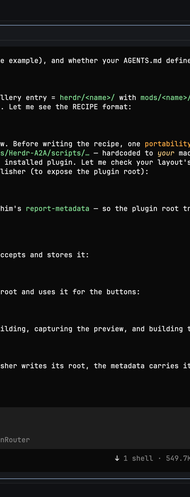

# supreme-consciousness

A live coordination panel added to your existing Herdr window: which OpenCode
agents are on the mesh, what each owes and has delivered, live transitions as
they happen, a one-click agent-to-agent greeting test, and a human-review
history of every request between agents — all read from the coordination
store, which stays the single source of truth. Your sidebar, status bar,
theme and other panels stay as they are.



## What you see

- A **Coordination** block (sized by your layout) with five sections:
  - **Agent rows**: one per live OpenCode pane — merged status (TUI signal +
    server execution map), per-pane `in / out / wait` counters, and both
    signals shown when they disagree (`working · tui reports idle`).
  - **Remote peers**: one row per configured SSH peer — reachability, agent
    count on the peer, or the reason it was unreachable. Fed by a name +
    counts snapshot (`metadata/peers.json`) the plugin's refresh loop
    publishes every few seconds; tokens never appear in it. Stale snapshot =
    the coordinating service is quiet, not that the peer went away.
  - **Hello test**: a **▶ say hello** button that starts an agent-to-agent
    greeting cascade, a **✕ cancel** button, and a live leg watch — every leg
    with its state, the handback summaries, and a verdict line.
  - **Mailbox**: the in/out chips are clickable. Clicking one opens that
    agent's mailbox inline — the exact items the chip counts (work orders,
    delivered receipts, handbacks, remote placeholders; newest first, with a
    `show all` beyond ten). Clicking an item opens its detail card via
    `herdr request`: brief, origin → recipient, state, result summary and the
    transition trail — or a remote request's cached SSH receipt. The same
    request may legitimately appear twice (order + handback are two pieces of
    mail), so item element ids are unique per row, not per request.
  - **Now**: the live transition feed (`enqueue → attempt → submitted →
    accept → finish`), newest first. Click any agent row to focus its pane.
- Window badge `⇄ N` while coordination work is owed.

## How it behaves

- Refreshes every 2 seconds while shown. The panel is **presentation-only**:
  it reads the coordination store and published metadata and never mutates
  them — the ▶ and ✕ buttons shell out to the plugin's scripts.
- The only buttons: **▶ say hello** and **✕ cancel** (hello-test cleanup).
- Agent rows bind panes to sessions by the TUI's own display signal
  (`time.viewed`), so `/new`, restarts and orphan cleanup cannot desync the
  panel from what each window actually shows.
- Clicks focus panes. Nothing else mutates.

## Requirements — the panel is the presentation layer of a plugin

This mod renders data produced by the **supreme-consciousness plugin** (an OpenCode
plugin): the coordination store, per-pane metadata and the inventory shim.
Without the plugin the panel renders but reports
*"Coordination metadata unavailable"*. Install the plugin first — see
[Install the coordination plugin](#install-the-coordination-plugin).

The plugin needs: Node ≥ 22, OpenCode, and Herdr with herdr-core. Agents run
through OpenCode; the mesh spans machines via the plugin's SSH transport
(see the plugin README).

## Add to the existing window

1. Read `~/.config/herdr-app/AGENTS.md` and every mod file first. Tell the
   person that this panel reads the coordination store and published
   metadata, and that its two buttons run `node` against the installed
   plugin's scripts.
2. Copy `mods/supreme-consciousness/` into Herdr's home
   (`~/.config/herdr-app/mods/`). If it already holds this panel, update that
   installation instead of installing a duplicate.
3. Add this block to the layout where the panel should live (a sidebar column
   is typical; `weight`/`min` are yours to tune). **The shipped `main` layout
   is read-only** — clone it first (`herdr-app do layout.clone
   '{"name":"main","as":"main-coordination"}'`) and edit the clone:

   ```json
   { "id": "coordination", "type": "block", "size": { "weight": 1.4 },
     "min": 260, "content": { "mod": "supreme-consciousness" } }
   ```

   Reuse the node if a coordination block already exists; do not append
   duplicates, and do not touch unrelated nodes.
4. Check the mod with `herdr-app check ~/.config/herdr-app/mods/supreme-consciousness`
   and try it in the app. No key bindings are required.

## Install the coordination plugin

On the machine whose agents should join the mesh:

1. `git clone https://github.com/GoliathDeveloper/supreme-consciousness "$HOME/.local/share/supreme-consciousness"`
   then `cd "$HOME/.local/share/supreme-consciousness" && npm install && npm run build`
   (a full `npm install` — the build needs `typescript`, a devDependency; `--omit=dev` breaks it. `dist/` is shipped, so the build is optional if you don't need source fixes.)
2. Register the plugin in `~/.config/opencode/opencode.jsonc`:
   `"plugins": [ { "package": "<the absolute path above>" } ]`
   The plugin hot-loads — restart the OpenCode service only if the tools do not appear.
4. Install the inventory shim:
   `cp bridge/herdr-shim.mjs "$HOME/.local/bin/herdr" && chmod +x "$HOME/.local/bin/herdr"`
5. **For `open_agent` provisioning** (optional), export `HERDR_ENV=1` plus
   `HERDR_SOCKET_PATH="$HOME/.local/state/herdr-core/default/default.sock"` and
   compute `HERDR_PANE_ID` from `HC_TERMINAL_ID` at shell start (the plugin
   README has the snippet), then open a new tab. The TUI sidebar and the
   coordination worker need none of these — the sidebar renders everywhere,
   degrading gracefully outside Herdr.
6. Verify (each should pass):
   ```sh
   herdr agent list | python3 -c "import json,sys; print('agents:', len(json.load(sys.stdin)['result']['agents']))"
   herdr review 1
   herdr mailbox <sessionId>   # the items behind a pane's in/out chips
   ls ~/.local/state/supreme-consciousness/metadata   # files appear within ~2s per agent
   ```

The plugin's own README covers agent-to-agent requests, the integrity guard,
cross-machine peers (SSH + token pairing) and the request lifecycle.
Cross-machine note: the peer needs bun or node; the helper runtime is
auto-detected per peer (PATH, then `~/.bun/bin/bun`, `/usr/local/bin/node`,
`/opt/homebrew/bin/node`) and `HERDR_HELPER_RUNTIME` overrides.

## Watch out

- **The panel is read-only by design.** Mutations happen only through the two
  buttons (which call the plugin's scripts) and through the agents themselves.
  If something in the panel looks wrong, the store is where the truth lives —
  `node scripts/watch-store.mjs` from the plugin clone reads it directly.
- The `▶`/`✕` buttons locate the plugin's scripts via the `pluginRoot` that
  the plugin publishes with every metadata write. If the buttons fail, the
  plugin install is missing or stale — not the mod.
- Keep the coordination block outside any per-space panel stack if you want
  it persistent across space switches.
- Avoid `setShared` or `notify` during render; QuickJS rejects unparenthesized
  mixing of `??` and `||`/`&&`.

## Done when

- `herdr-app check ~/.config/herdr-app/mods/supreme-consciousness` passes.
- The existing window keeps its sidebar, status bar, theme, panels and keys —
  only the coordination block was added.
- With the plugin installed and an agent running, the panel shows the agent
  row with live counters, and a **▶ say hello** round produces legs in the
  watch that the store confirms.
